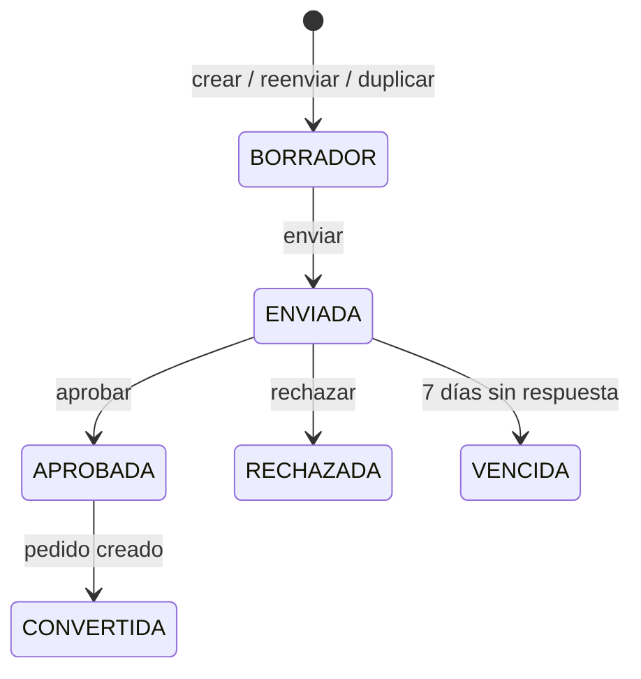
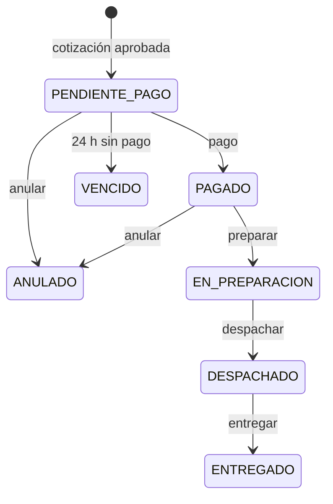

# API Ferretería — Guía para el frontend

Todas las llamadas pasan por el **API Gateway** en `http://localhost:8080`. Nunca se llama directo a un microservicio.

- Formato: JSON (`Content-Type: application/json`).
- Fechas: `LocalDate` → `"2026-10-13"`, `LocalDateTime` → `"2026-10-13T10:15:30"` (hora local del servidor, sin zona).
- Montos: números decimales con 2 decimales (`1228.50`), en soles, IGV incluido (18 %).
- CORS habilitado para `http://localhost:4200`, `http://localhost:5173` y `http://localhost:8086`.
- Las rutas `/internal/**` no son accesibles desde el gateway (responden `404`).

## Índice

1. [Autenticación y envío del token](#1-autenticación-y-envío-del-token)
2. [Errores comunes](#2-errores-comunes)
3. [ms-auth — usuarios](#3-ms-auth--usuarios)
4. [ms-clientes](#4-ms-clientes)
5. [ms-productos — catálogo y stock](#5-ms-productos--catálogo-y-stock)
6. [ms-cotizaciones](#6-ms-cotizaciones)
7. [ms-ventas — pedidos y despachos](#7-ms-ventas--pedidos-y-despachos)
8. [ms-notificaciones — notificaciones y dashboard](#8-ms-notificaciones--notificaciones-y-dashboard)
9. [Estados de cotización y pedido](#9-estados-de-cotización-y-pedido)
10. [WebSocket de avisos en tiempo real](#10-websocket-de-avisos-en-tiempo-real)

---

## 1. Autenticación y envío del token

### Roles

| Rol | Uso |
|---|---|
| `ADMIN` | Administra todo. Usuario inicial: `admin` / `admin123` (con los datos demo de Docker). |
| `VENDEDOR` | Atiende clientes y arma cotizaciones (canal `WEB`). |
| `CAJERO` | Cobra pedidos y emite comprobantes. |
| `ALMACENERO` | Gestiona stock, prepara y despacha pedidos. |
| `CLIENTE` | Se registra solo (app Android), cotiza y ve **solo lo suyo**. |

### Datos demo

Al crear el volumen de PostgreSQL (`docker compose up -d` por primera vez, o tras `docker compose down -v`), `docker/postgres/01-init.sql` crea las bases y `docker/postgres/02-datos.sql` carga datos de prueba: 13 clientes, 8 categorías, 32 productos con stock en ambos almacenes (2 en stock crítico) y sin cotizaciones ni pedidos.

| Usuario | Contraseña | Rol |
|---|---|---|
| `admin` | `admin123` | `ADMIN` |
| `vendedor` | `vendedor123` | `VENDEDOR` |
| `cajero` | `cajero123` | `CAJERO` |
| `almacenero` | `almacenero123` | `ALMACENERO` |
| `usuario` | `usuario123` | `CLIENTE` (minorista, DNI) |
| `contratista` | `contratista123` | `CLIENTE` (contratista, RUC) |

Si la base se crea vacía (sin `02-datos.sql`), el sistema crea `admin` / `Admin123`.

### POST `/api/auth/login` — público

Request:

```json
{
  "username": "admin",
  "password": "admin123"
}
```

Response `200`:

```json
{
  "token": "eyJhbGciOiJIUzI1NiJ9.eyJzdWIiOiIxIiwidXNlcm5hbWUiOiJhZG1pbiIsInJvbCI6IkFETUlOIiwiY2xpZW50ZUlkIjpudWxsLCJpYXQiOjE3NjAzNjQ4MDAsImV4cCI6MTc2MDM5MzYwMH0.Xx...",
  "idUsuario": 1,
  "nombreCompleto": "Administrador",
  "rol": "ADMIN"
}
```

Errores: `401` "Usuario o contraseña incorrectos", `403` "El usuario está inactivo".

### Cómo enviar el token

En **todas** las rutas (salvo login y registro) se envía la cabecera:

```
Authorization: Bearer <token>
```

- El token es un JWT HS256 que **dura 8 horas**. Al expirar, el gateway responde `401` y hay que volver a hacer login.
- Claims útiles si se decodifica el token: `sub` (idUsuario), `username`, `nombre` (nombre completo del usuario), `rol`, `clienteId` (solo para rol `CLIENTE`, `null` en los demás). Los tokens emitidos antes de este cambio no traen `nombre`: hay que volver a hacer login.
- El gateway valida el token y el rol, y reenvía al microservicio las cabeceras `X-User-Id`, `X-User-Role`, `X-User-Nombre` (el claim `nombre` codificado en URL, UTF-8, porque lleva tildes) y `X-Cliente-Id`. El frontend **no** debe enviarlas: si las envía, el gateway las descarta.
- En el WebSocket el token va como query param `?token=` (ver [sección 10](#10-websocket-de-avisos-en-tiempo-real)).

### POST `/api/auth/registro` — público

Crea un usuario con rol `CLIENTE` y su ficha en ms-clientes (tipo `MINORISTA`).

Request:

```json
{
  "username": "jperez",
  "nombreCompleto": "Juan Pérez Quispe",
  "email": "jperez@gmail.com",
  "password": "Clave123",
  "tipoDocumento": "DNI",
  "numeroDocumento": "45678912",
  "telefono": "987654321"
}
```

`tipoDocumento`: `DNI` (8 dígitos) o `RUC` (11 dígitos). `telefono` es opcional.

Response `201`:

```json
{
  "idUsuario": 7,
  "username": "jperez",
  "nombreCompleto": "Juan Pérez Quispe",
  "email": "jperez@gmail.com",
  "rol": "CLIENTE",
  "clienteId": 15,
  "activo": true,
  "fechaCreacion": "2026-10-13T10:15:30"
}
```

Errores: `400` validación / documento inválido, `409` "El username ya está registrado", "El email ya está registrado" o "El documento ya está registrado", `503` si ms-clientes no responde.

### GET `/api/auth/me` — cualquier rol autenticado

Response `200`: mismo formato que `UsuarioResponse` del registro, con los datos del usuario del token.

---

## 2. Errores comunes

Errores de los microservicios (`400`, `403`, `404`, `409`):

```json
{
  "status": 400,
  "mensaje": "Solo se puede aprobar una cotización ENVIADA y vigente",
  "fecha": "2026-10-13T10:15:30.123"
}
```

En errores de validación (`@Valid`), `mensaje` junta los mensajes de cada campo separados por coma.

Errores del gateway:

| Caso | Status | Body |
|---|---|---|
| Sin token | `401` | `{"status":401,"mensaje":"Token no enviado"}` |
| Token inválido o expirado | `401` | `{"status":401,"mensaje":"Token inválido o expirado"}` |
| Rol sin permiso | `403` | `{"status":403,"mensaje":"No tiene permisos para este recurso"}` |
| Ruta `/internal/**` | `404` | `{"status":404,"error":"NOT_FOUND"}` |
| Microservicio caído o lento (>10 s) | `503` | ver abajo |

```json
{
  "status": 503,
  "error": "SERVICE_UNAVAILABLE",
  "servicio": "ms-ventas",
  "mensaje": "El servicio ms-ventas no está disponible en este momento. Intente nuevamente en unos minutos.",
  "timestamp": "2026-10-13T10:15:30.123-05:00"
}
```

Un `GET` por id que no existe devuelve `404` **sin body**.

---

## 3. ms-auth — usuarios

Gestión de usuarios internos. **Todas las rutas `/api/usuarios/**` son solo `ADMIN`.**

| Método | Ruta | Roles | Descripción |
|---|---|---|---|
| GET | `/api/usuarios` | ADMIN | Lista todos los usuarios |
| GET | `/api/usuarios/{id}` | ADMIN | Obtiene un usuario |
| POST | `/api/usuarios` | ADMIN | Crea un usuario interno |
| PUT | `/api/usuarios/{id}` | ADMIN | Edita un usuario interno |
| PATCH | `/api/usuarios/{id}/estado?activo=false` | ADMIN | Activa / desactiva |

### Request — POST / PUT `/api/usuarios`

```json
{
  "username": "mrojas",
  "nombreCompleto": "María Rojas",
  "email": "mrojas@ferreteria.com",
  "password": "Venta2026",
  "rol": "VENDEDOR"
}
```

- `rol`: `ADMIN`, `VENDEDOR`, `ALMACENERO` o `CAJERO` (no se puede crear `CLIENTE` aquí).
- `password`: obligatoria al crear; al editar, si viene vacía o `null` se conserva la actual.
- No se pueden editar usuarios `CLIENTE` ni desactivar el propio usuario.

### Response — `UsuarioResponse` (POST `201`, resto `200`)

```json
{
  "idUsuario": 3,
  "username": "mrojas",
  "nombreCompleto": "María Rojas",
  "email": "mrojas@ferreteria.com",
  "rol": "VENDEDOR",
  "clienteId": null,
  "activo": true,
  "fechaCreacion": "2026-10-13T09:00:12"
}
```

`GET /api/usuarios` devuelve un arreglo de `UsuarioResponse`.

---

## 4. ms-clientes

| Método | Ruta | Roles | Descripción |
|---|---|---|---|
| GET | `/api/clientes?tipoCliente=&texto=` | ADMIN, VENDEDOR, CLIENTE | Lista / busca clientes |
| GET | `/api/clientes/{id}` | ADMIN, VENDEDOR, CAJERO, CLIENTE | Obtiene un cliente (CLIENTE solo el suyo, si no `403`; CAJERO solo esta consulta por id) |
| POST | `/api/clientes` | ADMIN, VENDEDOR | Crea un cliente |
| PUT | `/api/clientes/{id}` | ADMIN, VENDEDOR | Edita datos del cliente |
| PATCH | `/api/clientes/{id}/tipo?tipoCliente=CONTRATISTA` | ADMIN | Cambia el tipo de cliente |
| PATCH | `/api/clientes/{id}/estado?activo=false` | ADMIN | Activa / desactiva |
| GET | `/api/clientes/me` | CLIENTE | Ficha del cliente del token |
| PUT | `/api/clientes/me` | CLIENTE | Actualiza solo teléfono, email y dirección |

Filtros del listado: `tipoCliente` = `MINORISTA` | `CONTRATISTA`; `texto` busca por nombre o documento.

### Request — POST / PUT `/api/clientes` y PUT `/api/clientes/me`

```json
{
  "tipoDocumento": "RUC",
  "numeroDocumento": "20601234567",
  "nombreRazonSocial": "Constructora Los Andes S.A.C.",
  "telefono": "014567890",
  "email": "compras@losandes.pe",
  "direccion": "Av. Universitaria 1234, Los Olivos"
}
```

- `tipoDocumento`: `DNI` (8 dígitos) o `RUC` (11 dígitos). `nombreRazonSocial` es obligatorio al crear/editar.
- El PUT no cambia `tipoCliente` ni `activo` (tienen sus propios PATCH).
- Solo un cliente con `RUC` puede ser `CONTRATISTA` (precio contratista en las cotizaciones).
- En `PUT /api/clientes/me` solo se toman `telefono`, `email` y `direccion`.

### Response — `ClienteResponse` (POST `201`, resto `200`)

```json
{
  "idCliente": 4,
  "tipoDocumento": "RUC",
  "numeroDocumento": "20601234567",
  "nombreRazonSocial": "Constructora Los Andes S.A.C.",
  "tipoCliente": "CONTRATISTA",
  "telefono": "014567890",
  "email": "compras@losandes.pe",
  "direccion": "Av. Universitaria 1234, Los Olivos",
  "activo": true,
  "fechaRegistro": "2026-10-01T16:42:05"
}
```

Errores: `400` documento inválido / CONTRATISTA sin RUC, `409` "El documento ya está registrado".

---

## 5. ms-productos — catálogo y stock

Almacenes iniciales: `1` = `MOS` (Mostrador), `2` = `DEP` (Depósito).

| Método | Ruta | Roles | Descripción |
|---|---|---|---|
| GET | `/api/productos?idCategoria=&texto=&soloConStock=false&incluirInactivos=false` | Todos | Lista productos con disponibilidad |
| GET | `/api/productos/{id}` | Todos | Obtiene un producto |
| POST | `/api/productos` | ADMIN | Crea un producto (crea su stock en 0 en cada almacén) |
| PUT | `/api/productos/{id}` | ADMIN | Edita un producto |
| PATCH | `/api/productos/{id}/estado?activo=false` | ADMIN | Activa / desactiva |
| GET | `/api/productos/{id}/kardex` | ADMIN, ALMACENERO | Movimientos de stock del producto |
| GET | `/api/categorias` | Todos | Lista categorías |
| POST | `/api/categorias` | ADMIN | Crea una categoría |
| GET | `/api/almacenes` | Todos | Lista almacenes |
| GET | `/api/stock?idAlmacen=` | ADMIN, ALMACENERO, VENDEDOR | Stock por producto y almacén |
| GET | `/api/stock/criticos` | ADMIN, ALMACENERO | Stock con disponible ≤ stock mínimo |
| POST | `/api/stock/ajustes` | ADMIN, ALMACENERO | Fija la cantidad física (inventario) |
| POST | `/api/stock/ingresos` | ADMIN, ALMACENERO | Suma unidades (compra / reposición) |

"Todos" = cualquier usuario con token válido.

- `incluirInactivos=true` solo tiene efecto para `ADMIN`.
- Un producto inactivo devuelve `404` en `GET /{id}` para el rol `CLIENTE`.

### Request — POST / PUT `/api/productos`

```json
{
  "sku": "CEM-SOL-42",
  "nombre": "Cemento Sol Tipo I 42.5 kg",
  "descripcion": "Cemento portland de uso general",
  "idCategoria": 1,
  "unidadMedida": "bolsa",
  "precioMinorista": 32.50,
  "precioContratista": 30.90,
  "cantidadMinimaDescuento": 10,
  "porcentajeDescuento": 5,
  "stockMinimo": 20
}
```

Reglas: precios > 0, `precioContratista` ≤ `precioMinorista`, `porcentajeDescuento` entre 0 y 50, `stockMinimo` ≥ 0, SKU único (`409`). El descuento se aplica cuando la cantidad cotizada ≥ `cantidadMinimaDescuento`.

### Response — `ProductoResponse` (POST `201`, resto `200`)

```json
{
  "idProducto": 1,
  "sku": "CEM-SOL-42",
  "nombre": "Cemento Sol Tipo I 42.5 kg",
  "descripcion": "Cemento portland de uso general",
  "idCategoria": 1,
  "unidadMedida": "bolsa",
  "precioMinorista": 32.50,
  "precioContratista": 30.90,
  "cantidadMinimaDescuento": 10,
  "porcentajeDescuento": 5.00,
  "stockMinimo": 20,
  "activo": true,
  "fechaCreacion": "2026-10-01T08:00:00",
  "disponible": 460,
  "disponiblePorAlmacen": [
    { "idAlmacen": 1, "disponible": 60 },
    { "idAlmacen": 2, "disponible": 400 }
  ]
}
```

`disponible` = física − reservada, sumado en todos los almacenes.

### Categorías

POST request:

```json
{ "nombre": "Gasfitería" }
```

Response (`201` / listado `200`):

```json
{ "idCategoria": 7, "nombre": "Gasfitería", "activo": true }
```

### Almacenes — GET `/api/almacenes`

```json
[
  { "idAlmacen": 1, "codigo": "MOS", "nombre": "Mostrador" },
  { "idAlmacen": 2, "codigo": "DEP", "nombre": "Depósito" }
]
```

### Stock

POST `/api/stock/ingresos`:

```json
{ "idProducto": 1, "idAlmacen": 2, "cantidad": 100 }
```

POST `/api/stock/ajustes`:

```json
{ "idProducto": 1, "idAlmacen": 1, "nuevaCantidad": 55, "motivo": "Conteo físico: 5 bolsas rotas" }
```

`nuevaCantidad` no puede ser menor a la cantidad reservada (`400`).

Response de ingresos / ajustes (`200`) y elementos de `GET /api/stock` y `/api/stock/criticos`:

```json
{
  "idStock": 1,
  "idProducto": 1,
  "idAlmacen": 1,
  "cantidadFisica": 55,
  "cantidadReservada": 12,
  "disponible": 43,
  "productoActivo": true
}
```

`productoActivo` indica si el producto está activo; viene lleno en `GET /api/stock` y `/api/stock/criticos` y es `null` en las respuestas de ingresos / ajustes.

Si tras un ajuste (o una reserva de stock) `disponible` ≤ `stockMinimo`, se emite un aviso `stock.critico` (ver sección 10). Los ingresos no emiten aviso.

### Kardex — GET `/api/productos/{id}/kardex`

```json
[
  {
    "idMovimiento": 31,
    "idProducto": 1,
    "idAlmacen": 1,
    "tipo": "RESERVA",
    "cantidad": 12,
    "saldoFisico": 60,
    "referencia": "COT-2026-000012",
    "fecha": "2026-10-13T11:02:44"
  }
]
```

`tipo`: `INGRESO`, `AJUSTE`, `RESERVA`, `LIBERACION`, `SALIDA_VENTA`.

---

## 6. ms-cotizaciones

**Todas las rutas: ADMIN, VENDEDOR, CLIENTE.** Un `CLIENTE` solo ve y opera sus propias cotizaciones (`403` si no); para él `clienteId` se toma del token y el canal es `ANDROID`. Para VENDEDOR / ADMIN `clienteId` es obligatorio y el canal es `WEB`.

| Método | Ruta | Descripción | Respuesta |
|---|---|---|---|
| GET | `/api/cotizaciones?estado=&clienteId=&desde=&hasta=` | Lista (CLIENTE: solo las suyas) | `200` arreglo |
| GET | `/api/cotizaciones/{id}` | Detalle con items e historial | `200` |
| POST | `/api/cotizaciones` | Crea en `BORRADOR` | `201` |
| POST | `/api/cotizaciones/simular` | Calcula precios sin guardar | `200` |
| PUT | `/api/cotizaciones/{id}/items` | Reemplaza los items (solo `BORRADOR`) | `200` |
| POST | `/api/cotizaciones/{id}/enviar` | `BORRADOR` → `ENVIADA` (vigencia 7 días) | `200` |
| POST | `/api/cotizaciones/{id}/aprobar` | `ENVIADA` → `APROBADA`, reserva stock y genera el pedido | `200` |
| POST | `/api/cotizaciones/{id}/rechazar` | `ENVIADA` → `RECHAZADA` | `200` |
| POST | `/api/cotizaciones/{id}/reenviar` | Copia una `VENCIDA`/`RECHAZADA` como nuevo `BORRADOR` con precios actuales | `201` |
| POST | `/api/cotizaciones/{id}/duplicar` | Copia cualquier cotización como nuevo `BORRADOR` | `201` |

Filtros: `estado` (ver [sección 9](#9-estados-de-cotización-y-pedido)), `desde` / `hasta` en formato `yyyy-MM-dd`.

### Request — POST `/api/cotizaciones` y `/simular`

```json
{
  "clienteId": 15,
  "idAlmacen": 1,
  "items": [
    { "idProducto": 1, "cantidad": 12 },
    { "idProducto": 3, "cantidad": 20 }
  ]
}
```

- De 1 a 50 items, sin productos repetidos, cantidad > 0.
- El cliente debe estar activo y los productos activos.
- El precio sale del tipo de cliente (`MINORISTA` → precio minorista, `CONTRATISTA` → precio contratista) y del descuento por cantidad del producto.

### Request — PUT `/api/cotizaciones/{id}/items`

Arreglo de items (reemplaza todos):

```json
[
  { "idProducto": 1, "cantidad": 15 },
  { "idProducto": 5, "cantidad": 2 }
]
```

### Request — POST `/api/cotizaciones/{id}/rechazar`

```json
{ "motivo": "Encontré mejor precio en otra ferretería" }
```

`enviar`, `aprobar`, `reenviar` y `duplicar` no llevan body.

### Response — `CotizacionResponse`

Ejemplo para un cliente `MINORISTA`: 12 bolsas de cemento (32.50, 5 % por llevar ≥ 10) y 20 varillas de fierro (42.90, sin descuento, el mínimo es 50).

```json
{
  "idCotizacion": 12,
  "codigo": "COT-2026-000012",
  "clienteId": 15,
  "clienteNombre": "Juan Pérez Quispe",
  "tipoCliente": "MINORISTA",
  "vendedorId": null,
  "canal": "ANDROID",
  "idAlmacen": 1,
  "estado": "ENVIADA",
  "subtotal": 1248.00,
  "descuentoTotal": 19.50,
  "igv": 187.40,
  "total": 1228.50,
  "fechaCreacion": "2026-10-13T10:20:11",
  "fechaVencimiento": "2026-10-20T10:25:03",
  "fechaAprobacion": null,
  "motivoRechazo": null,
  "cotizacionOrigenId": null,
  "items": [
    {
      "idItem": 21,
      "idProducto": 1,
      "sku": "CEM-SOL-42",
      "nombreProducto": "Cemento Sol Tipo I 42.5 kg",
      "cantidad": 12,
      "precioUnitario": 32.50,
      "porcentajeDescuento": 5.00,
      "subtotal": 370.50
    },
    {
      "idItem": 22,
      "idProducto": 3,
      "sku": "FIE-12-9M",
      "nombreProducto": "Fierro corrugado 1/2\" x 9 m",
      "cantidad": 20,
      "precioUnitario": 42.90,
      "porcentajeDescuento": 0.00,
      "subtotal": 858.00
    }
  ],
  "historial": [
    {
      "idHistorial": 30,
      "estadoAnterior": null,
      "estadoNuevo": "BORRADOR",
      "usuarioId": 7,
      "usuarioNombre": "María Rojas",
      "fecha": "2026-10-13T10:20:11",
      "comentario": "Cotización creada"
    },
    {
      "idHistorial": 31,
      "estadoAnterior": "BORRADOR",
      "estadoNuevo": "ENVIADA",
      "usuarioId": 7,
      "usuarioNombre": "María Rojas",
      "fecha": "2026-10-13T10:25:03",
      "comentario": null
    }
  ]
}
```

Cálculo de importes:

- `subtotal` = Σ precioUnitario × cantidad (sin descuento).
- `total` = Σ subtotal de items (ya con descuento, IGV incluido).
- `descuentoTotal` = `subtotal` − `total`.
- `igv` = `total` − `total` / 1.18.

Notas:

- En `/simular` la respuesta no tiene `idCotizacion`, `codigo`, `idItem` ni historial.
- `usuarioNombre` en el historial es el nombre de quien hizo el cambio; es `null` en registros antiguos y en cambios automáticos (vencimiento, conversión a pedido).
- Un item puede traer `"aviso": "Stock insuficiente en el almacén: disponible 8"` (el campo se omite si no hay aviso). Es solo informativo; al **aprobar**, si falta stock la API responde `409`:

```json
{
  "status": 409,
  "mensaje": "Stock insuficiente para 1 producto(s)",
  "fecha": "2026-10-13T10:40:00.512",
  "faltantes": [
    { "idProducto": 3, "nombre": "Fierro corrugado 1/2\" x 9 m", "solicitado": 20, "disponible": 8 }
  ]
}
```

- Al aprobar se crea automáticamente el pedido en ms-ventas (estado `PENDIENTE_PAGO`) y la cotización pasa a `CONVERTIDA` unos instantes después (asíncrono vía RabbitMQ).

---

## 7. ms-ventas — pedidos y despachos

Los pedidos **no se crean por API**: nacen al aprobar una cotización.

| Método | Ruta | Roles | Descripción |
|---|---|---|---|
| GET | `/api/pedidos?estado=&clienteId=&desde=&hasta=` | ADMIN, VENDEDOR, CAJERO, ALMACENERO, CLIENTE | Lista (CLIENTE: solo los suyos) |
| GET | `/api/pedidos/cliente/{clienteId}` | ADMIN, VENDEDOR, CAJERO, ALMACENERO, CLIENTE | Historial de un cliente (CLIENTE: solo el suyo) |
| GET | `/api/pedidos/{id}` | ADMIN, VENDEDOR, CAJERO, ALMACENERO, CLIENTE | Detalle (CLIENTE: solo el suyo) |
| GET | `/api/pedidos/{id}/comprobante` | ADMIN, VENDEDOR, CAJERO, ALMACENERO, CLIENTE | Comprobante emitido |
| POST | `/api/pedidos/{id}/pago` | ADMIN, CAJERO | Registra el pago: `PENDIENTE_PAGO` → `PAGADO` |
| POST | `/api/pedidos/{id}/comprobante` | ADMIN, CAJERO | Emite boleta o factura (pedido pagado) |
| POST | `/api/pedidos/{id}/anular` | ADMIN | `PENDIENTE_PAGO`/`PAGADO` → `ANULADO` |
| GET | `/api/despachos/pendientes` | ADMIN, ALMACENERO | Pedidos `PAGADO` y `EN_PREPARACION` |
| POST | `/api/pedidos/{id}/preparar` | ADMIN, ALMACENERO | `PAGADO` → `EN_PREPARACION` |
| PUT | `/api/pedidos/{id}/checklist` | ADMIN, ALMACENERO | Marca items preparados |
| POST | `/api/pedidos/{id}/despachar` | ADMIN, ALMACENERO | `EN_PREPARACION` → `DESPACHADO` |
| POST | `/api/pedidos/{id}/entregar` | ADMIN, ALMACENERO | `DESPACHADO` → `ENTREGADO` |

### Request — POST `/api/pedidos/{id}/pago`

```json
{
  "metodo": "YAPE_PLIN",
  "monto": 1228.50,
  "numeroOperacion": "00458721",
  "tipoEntrega": "DELIVERY",
  "direccionEntrega": "Jr. Los Pinos 456, San Martín de Porres"
}
```

- `metodo`: `EFECTIVO`, `TARJETA`, `YAPE_PLIN`, `TRANSFERENCIA`. `numeroOperacion` es obligatorio salvo en `EFECTIVO`.
- Pago al contado: `monto` debe ser **exactamente** igual al `total` del pedido.
- `tipoEntrega`: `RECOJO` o `DELIVERY`; con `DELIVERY` la `direccionEntrega` es obligatoria.
- El pedido debe pagarse dentro de 24 h desde su creación (`fechaLimitePago`); si no, pasa a `VENCIDO` y se libera la reserva.

### Request — POST `/api/pedidos/{id}/comprobante`

```json
{
  "tipo": "BOLETA",
  "documentoCliente": "45678912",
  "razonSocial": "Juan Pérez Quispe"
}
```

`BOLETA` requiere DNI de 8 dígitos (serie `B001`); `FACTURA` requiere RUC de 11 dígitos (serie `F001`). `razonSocial` es opcional (por defecto, el nombre del cliente). Solo un comprobante por pedido (`409` si ya existe).

Response `201` (y GET `/api/pedidos/{id}/comprobante`):

```json
{
  "idComprobante": 5,
  "idPedido": 9,
  "tipo": "BOLETA",
  "serie": "B001",
  "numero": 5,
  "numeroComprobante": "B001-5",
  "documentoCliente": "45678912",
  "razonSocial": "Juan Pérez Quispe",
  "subtotal": 1041.10,
  "igv": 187.40,
  "total": 1228.50,
  "fechaEmision": "2026-10-13T11:05:40"
}
```

### Request — POST `/api/pedidos/{id}/anular`

```json
{ "motivo": "Cliente desistió de la compra" }
```

Si el pedido estaba pagado, el pago queda marcado `devuelto: true`. Se libera la reserva de stock.

### Request — PUT `/api/pedidos/{id}/checklist`

IDs de `items[].idItem` del pedido que ya están listos (se pueden enviar en varias llamadas):

```json
{ "itemsPreparados": [17, 18] }
```

### Request — POST `/api/pedidos/{id}/despachar`

Body opcional. Para `DELIVERY` el repartidor es obligatorio:

```json
{ "repartidor": "Carlos Mendoza" }
```

Para despachar, todos los items deben estar `preparado: true`. Al despachar se descuenta el stock físico (`SALIDA_VENTA`).

`preparar` y `entregar` no llevan body.

### Response — `PedidoResponse`

```json
{
  "idPedido": 9,
  "codigo": "PED-2026-000009",
  "cotizacionId": 12,
  "codigoCotizacion": "COT-2026-000012",
  "clienteId": 15,
  "clienteNombre": "Juan Pérez Quispe",
  "idAlmacen": 1,
  "estado": "EN_PREPARACION",
  "total": 1228.50,
  "tipoEntrega": "DELIVERY",
  "direccionEntrega": "Jr. Los Pinos 456, San Martín de Porres",
  "repartidor": null,
  "fechaCreacion": "2026-10-13T10:40:02",
  "fechaLimitePago": "2026-10-14T10:40:02",
  "fechaPago": "2026-10-13T11:02:15",
  "fechaPreparacion": "2026-10-13T11:30:00",
  "fechaDespacho": null,
  "fechaEntrega": null,
  "almaceneroId": 4,
  "almaceneroNombre": "Luis Paredes",
  "motivoAnulacion": null,
  "items": [
    {
      "idItem": 17,
      "idProducto": 1,
      "sku": "CEM-SOL-42",
      "nombreProducto": "Cemento Sol Tipo I 42.5 kg",
      "cantidad": 12,
      "precioUnitario": 32.50,
      "subtotal": 370.50,
      "preparado": true
    },
    {
      "idItem": 18,
      "idProducto": 3,
      "sku": "FIE-12-9M",
      "nombreProducto": "Fierro corrugado 1/2\" x 9 m",
      "cantidad": 20,
      "precioUnitario": 42.90,
      "subtotal": 858.00,
      "preparado": false
    }
  ],
  "pago": {
    "idPago": 6,
    "metodo": "YAPE_PLIN",
    "monto": 1228.50,
    "numeroOperacion": "00458721",
    "cajeroId": 5,
    "cajeroNombre": "Ana Quispe",
    "fecha": "2026-10-13T11:02:15",
    "devuelto": false
  },
  "comprobante": {
    "idComprobante": 5,
    "idPedido": 9,
    "tipo": "BOLETA",
    "serie": "B001",
    "numero": 5,
    "numeroComprobante": "B001-5",
    "documentoCliente": "45678912",
    "razonSocial": "Juan Pérez Quispe",
    "subtotal": 1041.10,
    "igv": 187.40,
    "total": 1228.50,
    "fechaEmision": "2026-10-13T11:05:40"
  }
}
```

`pago` y `comprobante` son `null` mientras no existan.

`almaceneroNombre` (quien preparó el pedido) y `pago.cajeroNombre` (quien cobró) son `null` en registros antiguos.

---

## 8. ms-notificaciones — notificaciones y dashboard

| Método | Ruta | Roles | Descripción |
|---|---|---|---|
| GET | `/api/notificaciones?soloNoLeidas=false` | Todos | Notificaciones del rol del token (CLIENTE: las de su clienteId) |
| PATCH | `/api/notificaciones/{id}/leida` | Todos | Marca como leída (solo si es del usuario, si no `403`) |
| GET | `/api/dashboard/resumen` | ADMIN | KPIs de hoy, 7 días y mes |
| GET | `/api/dashboard/ventas?desde=&hasta=` | ADMIN | Ventas por día |
| GET | `/api/dashboard/top-productos` | ADMIN | Productos más aprobados |
| GET | `/api/dashboard/top-clientes` | ADMIN | Clientes que más compran |

### Response — `NotificacionResponse`

```json
{
  "idNotificacion": 41,
  "tipo": "venta.pagada",
  "titulo": "Pedido pagado",
  "mensaje": "Pedido PED-2026-000009 pagado - S/ 1228.50 - listo para preparar",
  "rolDestino": "ALMACENERO",
  "clienteId": null,
  "referenciaId": 9,
  "leida": false,
  "fecha": "2026-10-13T11:02:15"
}
```

- Va a un rol (`rolDestino` lleno, `clienteId` null) **o** a un cliente (`rolDestino` null, `clienteId` lleno).
- `referenciaId`: id de la cotización (`cotizacion.*`), del pedido (`venta.*`, `pedido.*`) o del producto (`stock.critico`).
- `tipo` y destinatarios: ver tabla en la [sección 10](#tipos-de-aviso-y-destinatarios).

`PATCH /{id}/leida` no lleva body y devuelve la notificación con `"leida": true`.

### GET `/api/dashboard/resumen`

```json
{
  "montoHoy": 1228.50,
  "pedidosHoy": 1,
  "montoUltimos7Dias": 8450.30,
  "pedidosUltimos7Dias": 9,
  "montoMes": 21870.90,
  "pedidosMes": 24,
  "cotizacionesEnviadasMes": 40,
  "tasaConversionMes": 60.00,
  "alertasStock": [
    {
      "idNotificacion": 38,
      "tipo": "stock.critico",
      "titulo": "Stock crítico",
      "mensaje": "Cable THW 14 AWG x 100 m: quedan 4 unidades en el almacén 1 (mínimo 5)",
      "rolDestino": "ADMIN",
      "clienteId": null,
      "referenciaId": 7,
      "leida": false,
      "fecha": "2026-10-13T09:12:00"
    }
  ]
}
```

`tasaConversionMes` es un porcentaje: pedidos pagados del mes × 100 / cotizaciones enviadas del mes.

### GET `/api/dashboard/ventas?desde=2026-10-07&hasta=2026-10-13`

```json
[
  { "fecha": "2026-10-12", "monto": 2310.40, "pedidos": 3 },
  { "fecha": "2026-10-13", "monto": 1228.50, "pedidos": 1 }
]
```

### GET `/api/dashboard/top-productos`

```json
[
  { "idProducto": 1, "nombre": "Cemento Sol Tipo I 42.5 kg", "unidadesAprobadas": 340, "montoAprobado": 10497.50 }
]
```

### GET `/api/dashboard/top-clientes`

```json
[
  { "clienteId": 4, "nombre": "Constructora Los Andes S.A.C.", "compras": 6, "montoComprado": 15230.00 }
]
```

---

## 9. Estados de cotización y pedido

### Cotización (`EstadoCotizacion`)

| Estado | Significado | Acciones permitidas |
|---|---|---|
| `BORRADOR` | Recién creada, editable | `PUT /items`, `enviar`, `duplicar` |
| `ENVIADA` | Enviada al cliente; vence a los 7 días (`fechaVencimiento`) | `aprobar` (si sigue vigente), `rechazar`, `duplicar` |
| `APROBADA` | Aceptada; stock reservado y pedido en creación | `duplicar` |
| `RECHAZADA` | Rechazada con `motivoRechazo`; se libera la reserva | `reenviar`, `duplicar` |
| `VENCIDA` | Pasó la vigencia sin respuesta (automático, cada minuto) | `reenviar`, `duplicar` |
| `CONVERTIDA` | Ya generó su pedido en ms-ventas (automático) | `duplicar` |



### Pedido (`EstadoPedido`)

| Estado | Significado | Quién lo mueve |
|---|---|---|
| `PENDIENTE_PAGO` | Creado al aprobar la cotización; 24 h para pagar | — |
| `PAGADO` | Pago registrado | CAJERO / ADMIN (`pago`) |
| `EN_PREPARACION` | El almacén arma el pedido (checklist) | ALMACENERO / ADMIN (`preparar`) |
| `DESPACHADO` | Salió del almacén o listo para recojo; se descuenta stock | ALMACENERO / ADMIN (`despachar`) |
| `ENTREGADO` | Recibido por el cliente | ALMACENERO / ADMIN (`entregar`) |
| `ANULADO` | Anulado con motivo; pago devuelto y reserva liberada | ADMIN (`anular`) |
| `VENCIDO` | No se pagó en 24 h; reserva liberada (automático) | sistema |



Una transición no permitida responde `400` con el motivo en `mensaje`.

---

## 10. WebSocket de avisos en tiempo real

Los avisos se envían por **STOMP sobre WebSocket nativo** (sin SockJS) a través del gateway.

- URL: `ws://localhost:8080/ws?token=<JWT>`
- El navegador no puede enviar cabeceras en un WebSocket, por eso el token va en el query param `token` (URL-encoded). El gateway lo valida igual que el `Authorization`; si falta o es inválido, el handshake se rechaza con `401`.
- Solo se reciben mensajes (no hay destinos `/app` para enviar).
- Cada mensaje es un `NotificacionResponse` en JSON (mismo formato que la [sección 8](#response--notificacionresponse)). Además queda guardado y se puede consultar con `GET /api/notificaciones`.

### Tópicos

| Rol del token | Tópico al que puede suscribirse |
|---|---|
| `ADMIN` | `/topic/rol/ADMIN` |
| `VENDEDOR` | `/topic/rol/VENDEDOR` |
| `CAJERO` | `/topic/rol/CAJERO` |
| `ALMACENERO` | `/topic/rol/ALMACENERO` |
| `CLIENTE` | `/topic/cliente/{clienteId}` (el `clienteId` de su token) |

Cada usuario solo puede suscribirse a **su** tópico. Suscribirse a otro devuelve un frame `ERROR` ("No tiene permiso para suscribirse a ...") y se cierra la conexión.

### Tipos de aviso y destinatarios

| `tipo` | Destinatarios |
|---|---|
| `cotizacion.enviada` | VENDEDOR, ADMIN, cliente |
| `cotizacion.aprobada` | VENDEDOR, CAJERO, ADMIN, cliente |
| `cotizacion.rechazada` | VENDEDOR, ADMIN, cliente |
| `cotizacion.vencida` | VENDEDOR, ADMIN, cliente |
| `venta.creada` | CAJERO |
| `venta.pagada` | ALMACENERO, ADMIN, cliente |
| `venta.anulada` | CAJERO, ALMACENERO, ADMIN, cliente |
| `pedido.vencido` | CAJERO, ADMIN |
| `pedido.despachado` | ADMIN, cliente |
| `pedido.entregado` | ADMIN, cliente |
| `stock.critico` | ADMIN, ALMACENERO |

### Ejemplo con `@stomp/stompjs`

```js
import { Client } from '@stomp/stompjs';

const { token, rol } = sesion;                       // datos del login
const clienteId = decodificarJwt(token).clienteId;   // solo para CLIENTE

const topico = rol === 'CLIENTE' ? `/topic/cliente/${clienteId}` : `/topic/rol/${rol}`;

const cliente = new Client({
  brokerURL: `ws://localhost:8080/ws?token=${encodeURIComponent(token)}`,
  reconnectDelay: 5000,
  onConnect: () => {
    cliente.subscribe(topico, (mensaje) => {
      const aviso = JSON.parse(mensaje.body);
      console.log(aviso.titulo, aviso.mensaje);
    });
  },
  onStompError: (frame) => console.error(frame.headers.message),
});

cliente.activate();
```

Mensaje recibido de ejemplo (cliente 15):

```json
{
  "idNotificacion": 44,
  "tipo": "pedido.despachado",
  "titulo": "Pedido despachado",
  "mensaje": "Pedido PED-2026-000009 despachado - en camino o listo para recoger",
  "rolDestino": null,
  "clienteId": 15,
  "referenciaId": 9,
  "leida": false,
  "fecha": "2026-10-13T12:10:05"
}
```

Al expirar el token (8 h) la reconexión fallará: hay que hacer login de nuevo y crear el cliente STOMP con el token nuevo. Para probar sin frontend existe la página `ms-notificaciones/src/main/resources/static/prueba-ws.html`.